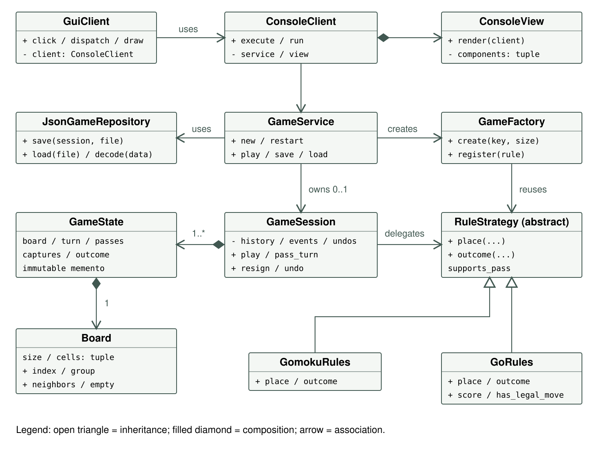
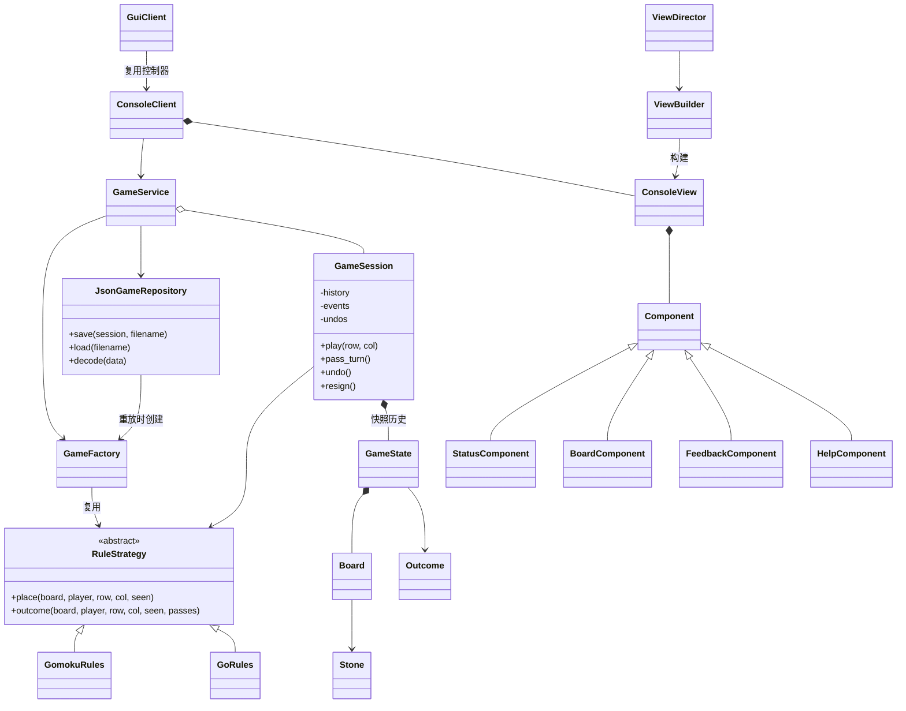

# 棋类对战平台第一阶段设计说明

本平台使用同一组操作接口运行五子棋和围棋本地双人对战。规则、状态维护、存档与客户端分层实现；控制台为基本入口，Tkinter 为可选图形入口。设计目标是在第一阶段完成规则和局面管理，并为后续新增棋种、客户端及存档形式保留扩展位置。

代码仓库：https://github.com/Jaredanwolfgang/gogogo

演示视频：[3 分 44 秒命令回放](../results/demo.mp4)。清华网盘链接与提交状态见 [submission.json](submission.json)，上传后填写 `cloud_video_url` 并重新编译 PDF。第二阶段需求尚未提供。

## 需求与实现对应

| 要求 | 实现与验收入口 |
| --- | --- |
| 五子棋与围棋、黑白交替 | `GameFactory` + `GameSession.play` |
| 提子、非法落点、虚着、终局 | `GoRules.place/outcome`，规则专项测试 |
| 连五获胜、满盘平局、认负 | `GomokuRules.outcome`，`GameSession.resign` |
| 开始、重开、8–19 棋盘 | `GameService.new/restart`，生命周期测试 |
| 悔棋一步与次数限制 | `GameState` 快照、`GameSession.undo` |
| 保存与读取覆盖 | `JsonGameRepository`，存档往返与损坏测试 |
| 状态、棋盘、反馈、提示开关 | `ViewDirector` 创建四个组件 |
| 前后端分离、统一对待棋种 | 客户端 → `GameService` → `GameSession` → `RuleStrategy` |
| 先设计后建造、减少对象开销 | Builder/Director 及枚举棋子与复用策略 |
| 可选 GUI | `GuiClient` 的 Canvas 棋盘、按钮与文件对话框 |

## 规则选择与边界

五子棋为自由规则，无禁手，横、竖、两斜线五子或长连均赢；先检查获胜再检查满盘。围棋采用整块提子、禁自杀和全局同形禁入。虚着豁免同形检查，否则第一次虚着就会错误地被当成重复盘面。

计分采用现行面积法：己方棋子 + 仅与己方接触的连通空域；共享空域和完全无棋子的空域不归任何一方，白贴 7.5 点。被提子数不再加入得分。两次连续虚着或双方都没有合法落点时结算；一方没有合法落点仍允许虚着。死子须在双虚着前实际提净，本阶段没有自动死活识别或赛制中的协商裁定程序。直接双虚着表示双方接受当前盘面，这是简化终局流程，并非完整中国/AGA 赛事规则实现。

悔棋撤销最近一个成功落子、虚着或认负动作，双方合计每局 3 次，允许从结束状态恢复。重开重置额度；存档重放保留额度。错误输入不消耗额度，不切换轮次，不生成历史。所有坐标在界面中从 1 开始、内部从 0 开始。

## 架构与 UML

### 模式选择

策略模式：`RuleStrategy` 定义落子与终局检查接口，`GomokuRules`、`GoRules` 提供差异规则。客户端和会话不以棋种条件分支复制整套流程，支持虚着的能力通过策略属性暴露。

简单工厂：`GameFactory` 解析游戏标识并创建会话，注册表允许加入新的策略。这是注册式简单工厂，不将其误称为 GoF 的工厂方法继承结构。

备忘录模式：`GameState` 是冻结数据类，`Board` 的棋盘数据是不可变元组。`GameSession` 同时承担发起人与管理者职责，历史保存快照引用。撤销直接移除最近状态，提子、轮次、虚着和终局信息一起恢复。

建造者与组合模式：`ViewDirector` 先确定状态、棋盘、反馈、帮助的布局顺序，再通过 `ViewBuilder.build` 实例化组件并组成 `ConsoleView`。叶组件与组合实现同一 `Component.render` 接口。每次刷新复用已建成的组件，只重新产生文字。

门面与依赖注入：`GameService` 隔离会话生命周期、文件仓库和客户端；构造时可注入工厂与仓库。Tkinter 客户端复用命令控制器，因此界面点击与终端输入进入同一业务路径。

共享对象：`Stone` 的三种枚举值避免为每个棋子建立可变对象，工厂复用不含对局状态的规则实例。这里采用享元思想，而不为三个枚举值增加一套额外享元工厂。没有可变全局对局，也不采用单例。

### 面向对象原则

单一职责体现在规则计算、会话维护、存档、命令解析和展示的分离。开闭原则体现在规则注册和可组合的显示组件；增加棋种主要添加策略，但新棋种若需要移动棋子等新命令，仍须扩展接口，并非所有第二阶段需求都能零修改完成。里氏替换要求各策略接受同样参数、返回同样结果或抛出 `GameError`。依赖倒置体现在会话依赖抽象 `RuleStrategy`，服务通过构造注入工厂及仓库；仓库目前是鸭子类型协议，没有为唯一实现强加抽象基类。

## 关键类与函数

| 类或函数 | 功能与不变量 |
| --- | --- |
| `Board.empty/index/group/neighbors` | 校验尺寸与坐标；迭代搜索棋块和气，避免递归深度问题 |
| `GomokuRules.outcome` | 从最后落点双向累计四个方向，连五优先于满盘平局 |
| `GoRules.place` | 暂放棋子、找出邻接无气敌块、统一提子、检查自杀与同形，返回新盘面 |
| `GoRules.score/has_legal_move/outcome` | 连通空域面积计分；枚举合法落点；自动结算 |
| `GameSession.play/pass_turn/resign` | 先完整校验并计算新快照，再加入历史和事件日志 |
| `GameSession.undo` | 恢复上一个快照，独立递增悔棋次数，写入撤销事件 |
| `GameService.new/restart/load` | 管理未开始、进行中、结束三种生命周期，读档成功后才替换会话 |
| `JsonGameRepository.save/load/decode` | 原子保存；有界解析；按规则重放并与声明局面对照 |
| `ConsoleClient.execute/run` | `shlex` 支持带空格路径；检查参数数目；反馈异常；EOF/Ctrl-C 正常退出 |
| `ViewDirector.construct` | 先布局，再构建组件，保证每种棋局共享同一界面 |
| `GuiClient.click/dispatch/draw` | 将鼠标坐标转换为行列，派发统一命令，绘制棋盘与黑白棋子 |

## 算法与状态一致性

围棋棋块用栈进行四邻接搜索，返回棋子集合与空点集合。落子阶段先在临时棋盘中检查敌块，统一移除无气棋块后再检查己方，因而允许“提子后取得气”的合法着手。全局同形键为整个棋盘元组，不包括轮次，与 positional superko 的定义一致；历史仅取尚未撤销的分支。

面积计分遍历未访问空点，扩展连通空域并收集邻接颜色。仅邻接一种颜色的空域归该颜色，两种或零种颜色均中立。自动终局会分别询问黑白双方是否存在合法落点，不能用棋盘填满代替围棋无子可下。

棋盘边长 n，交叉点 B=n²。五子棋末手连线检查 O(n)；棋块搜索与计分 O(B)；最坏枚举合法落点 O(B²)。设未撤销历史长度 H，当前实现每次操作构造同形集合 O(HB)，历史快照占 O(HB) 空间。最大 19×19 且操作日志上限 5000，使规模有界。虚着与认负的快照共享原 Board，撤销不复制整个历史。

存档版本 1 保存 game、size、events、position。所有成功动作（含 undo）按顺序保留，读档在独立新会话中逐步重放，保证终局后不能伪造后续行棋，且悔棋额度与同形历史保持一致。最终以规范 JSON 比较棋盘、轮次、提子、虚着、手数、额度和结果，避免布尔值与整数相等造成漏检。文件不是加密签名，验证的是结构和规则合法性，不是来源真实性。

保存先在目标文件同目录写临时文件并 flush/fsync，成功后 `os.replace`；替换失败保留旧文件并清理临时文件。读取最多 2 MiB，拒绝未知字段、重复 JSON 键、NaN、非法编码、深层嵌套、越界动作和不一致局面。客户端只解析语法，业务非法操作均由后端拒绝。

## 测试输入与实际输出

运行 `python3 -m unittest discover -s tests -v`。首版包含 29 项测试，完整实际记录见 [tests.txt](../results/tests.txt)。表中坐标均为控制台的一基坐标；单独规则测试会直接构造盘面，属于隔离测试，不冒充完整对局。

| 场景与输入 | 实际结果 |
| --- | --- |
| `new go 7` | 错误：棋盘边长必须是 8 到 19 的整数 |
| 已落 `(1,1)` 后再次 `play 1 1` | 错误：该位置已有棋子；轮次和历史不变 |
| 黑 `(1,1..5)`，白穿插 `(3,1..4)` | 黑方 X 获胜；连成五子 |
| 四方向各构造连续五子、白棋长连六子 | 全部返回对应颜色获胜 |
| 无五连的 8×8 满盘规则测试 | 棋盘已满，平局 |
| 围棋依次 `(1,2),(1,1),(8,8),(7,7),(2,1)` | 黑提 1 子，白 `(1,1)` 消失 |
| 接上例白 `play 1 1` | 禁止自杀；当前局面保持不变 |
| 上例 `undo` | 白 `(1,1)` 复原，黑提子数恢复为 0 |
| 合法劫形黑 `play 2 3` 后白 `play 2 2` | 禁止全局同形；立即回提失败 |
| 提子后存档 → restart → load | 棋盘、提子、轮次、历史与悔棋额度全部恢复 |
| 提子后的示例局面 `pass`、`pass` | 白方获胜；面积得分黑 4，白 8.5 |
| 三次 `play 1 1` + `undo` 后再次悔棋 | 悔棋次数超过限制 |
| 损坏 JSON、重复字段、伪造局面、缺失文件 | 提示读取失败，原会话对象保持不变 |
| 模拟 `os.replace` 磁盘异常 | 提示保存失败；旧文件字节不变，无残留临时文件 |

命令行端到端测试使用子进程走完一局五子棋并退出；GUI 使用本机窗口进行补充交互检查，结果见 `results/gui-check.txt`。自动测试不依赖图形桌面。

## 运行与演示

`python3 main.py` 启动控制台，`python3 main.py --gui` 启动图形模式。控制台只需 Python 3.9+ 标准库；GUI 另需可用的 Tk。Mac 自带旧 Tk 8.5 的兼容问题不影响控制台，推荐使用本机安装的 Python 3.12/Tk。

视频包含 56 个真实命令输出画面，每个 4 秒，共 224 秒：0:00–1:04 演示五子棋和错误操作，1:04–2:04 演示提子、禁自杀、悔棋、保存读取和计分，2:04–2:48 演示劫争，2:48–3:44 演示提示开关、未知指令与悔棋额度。视频由实际运行输出生成，是自动命令回放，不是人工录屏；完整文字输出保存在 `results/demo-transcript.txt`。

## 参考来源

- [Gomocup Detail Information](https://gomocup.org/detail-information/)：自由五子棋的五子或长连判胜。
- [British Go Association How to Play](https://www.britgo.org/intro/intro2.html)：棋块、气、提子、禁自杀、劫与虚着。
- [British Go Association AGA Rules Definition](https://media-iframe.britgo.org/rules/agarules.html)：面积与领地两种计分方法。
- [British Go Association Comparison of Some Go Rules](https://britgo.org/rules/compare.html)：规则体系与重复局面处理差异。

本项目采用上述资料中的基础规则和面积计分原理，并单独声明课程实现的终局与悔棋约定。参考时间为 2026 年 11 月 24 日。
